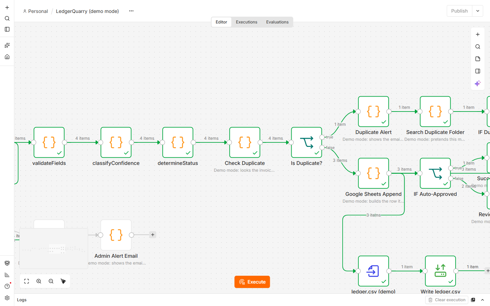
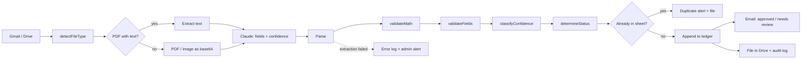
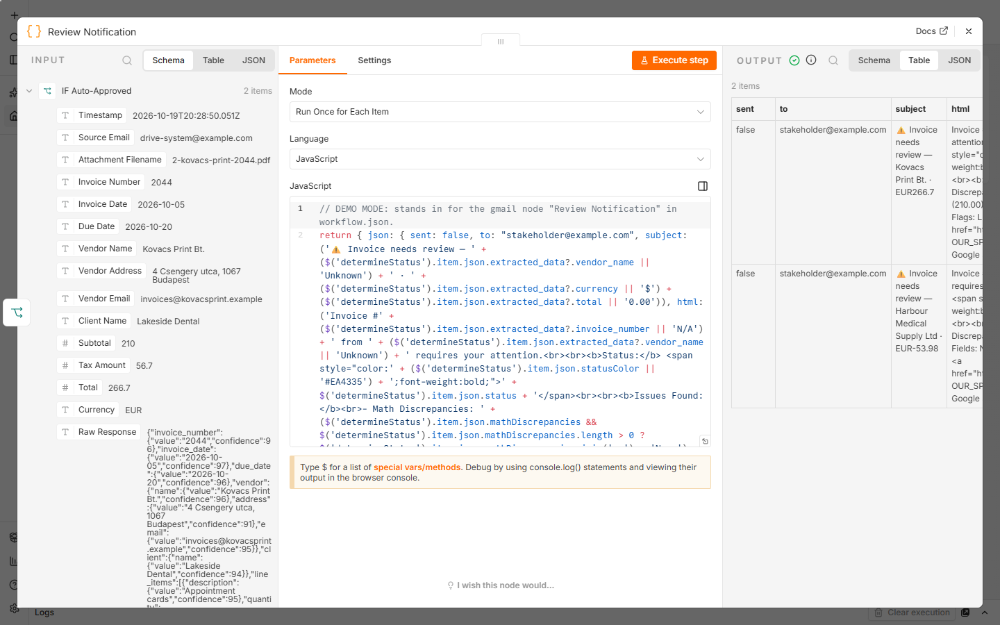

# LedgerQuarry: invoice extraction in n8n

[](https://github.com/arslanvuzmal/LedgerQuarry/actions/workflows/ci.yml)


An n8n workflow that takes invoices from Gmail or Google Drive, has Claude read them into JSON, checks
the numbers in plain code, and writes each invoice to a Google Sheet as **AUTO_APPROVED**,
**REVIEW_RECOMMENDED** or **REVIEW_REQUIRED**. Duplicates are kept out of the sheet and reported.

The project was previously called OmniExtract; some files still use that name.



---

## What it does

1. **In:** a Gmail attachment or a new file in a Drive folder (PDF, JPEG or PNG). The file type is read
   from the file's first bytes, not its name.
2. **Read:** text PDFs go to Claude as text (cut at 10,000 characters); scanned PDFs go as a PDF
   document and photos as an image. Claude returns every field with a confidence from 0 to 100.
3. **Check, in code, not by the model:**
   - line items must add up to the subtotal, and subtotal + tax to the total, within 0.02;
   - invoice number, date, total and vendor must be present; dates must be YYYY-MM-DD;
   - a negative total is a credit note.
4. **Decide:**
   - **REVIEW_REQUIRED** if the numbers do not add up, or the invoice number or total is missing;
   - **REVIEW_RECOMMENDED** if the average confidence is under 75, more than two fields are under 75,
     or it is a credit note;
   - **AUTO_APPROVED** otherwise.
5. **Duplicates:** an invoice whose vendor, number and total are already in the sheet is not written
   again; an alert email goes out and the file is filed under duplicates.
6. **Out:** a row in the ledger sheet, an email (approved, or needs review), the file filed in a month
   folder in Drive, and a row in the audit log. Failed extractions go to an error log and alert the admin.



The checks and the decision are the Code nodes `validateMath`, `validateFields`, `classifyConfidence`
and `determineStatus` in [`workflows/workflow.json`](workflows/workflow.json).

---

## Run the demo (no Google account, no Claude key)

Needs Docker and Node.js 20+.

```bash
node demo/make-samples.mjs            # four made-up invoices -> demo/inbox/
node scripts/build-demo-workflow.mjs  # workflows/demo-workflow.json
docker compose -f docker-compose.demo.yml up
```

Open http://localhost:5678, create the local owner account n8n asks for, open
**LedgerQuarry (demo mode)** and press **Execute workflow**. The ledger and audit log are written to
`demo/out/`. To run it without the editor:

```bash
docker compose -f docker-compose.demo.yml exec -e N8N_RUNNERS_BROKER_PORT=5681 n8n \
  n8n execute --id LedgerQuarryDemo
node demo/check-output.mjs
```

**What demo mode changes.** `scripts/build-demo-workflow.mjs` builds the demo from the real workflow.
The Code nodes with the logic are copied unchanged; only the outside services are replaced, each by a
node of the same name with a note on the canvas:

| Real workflow | Demo mode |
|---|---|
| Gmail / Drive triggers | A manual trigger that reads `demo/inbox/*.pdf` |
| Claude API call | The answer in [`demo/answers.json`](demo/answers.json), written by hand to match each sample. It is not model output. |
| Google Sheets (duplicate check, ledger, logs) | Last month's rows in [`demo/sheet-seed.json`](demo/sheet-seed.json); new rows go to `demo/out/*.csv` |
| Gmail sends | The email it would send, with `sent: false` |
| Google Drive filing | Where the file would be filed |

The four samples cover each path: an invoice that is approved, one whose line items do not add up
(the supplier's subtotal is wrong), a credit note, and an invoice that is already in the sheet.



---

## Run it for real

See [docs/INSTALLATION.md](docs/INSTALLATION.md) for the Google Cloud and n8n setup. You need:

| Credential in n8n | Used by |
|---|---|
| Gmail OAuth2 | Gmail trigger and the four emails |
| Google Drive OAuth2 | Drive trigger and filing |
| Google Sheets OAuth2 | Duplicate check, ledger, audit and error logs |
| Header auth with your Anthropic API key | Claude API Call |

Replace `YOUR_SPREADSHEET_ID_HERE` and `YOUR_PROCESSED_PARENT_FOLDER_ID_HERE` in the workflow. The
Claude call uses `claude-sonnet-5-5` with `max_tokens` 16000 and the server-side refusal fallback.

---

## Tests and CI

```bash
node --test tests/*.test.mjs
```

The tests run each Code node's source straight from `workflows/workflow.json`, so they test what ships:
the arithmetic and its 0.02 tolerance, required fields, dates, credit notes, the confidence rules, the
three statuses, parsing (including a thinking block before the answer, refusals and bad JSON), file-type
detection, and the structural fixes listed below.

CI ([`.github/workflows/ci.yml`](.github/workflows/ci.yml)) runs the tests, checks that
`demo-workflow.json` is up to date, and runs the demo in n8n 2.43.8, then checks what it wrote.

### Fixed by running it

Running the workflow end to end in n8n for the first time found these; each is now covered by a test:

- The model `claude-3-5-sonnet-20241022` is retired; the call now uses a current one.
- The reply was read from `content[0]`; a thinking block can come first.
- With no matching row, the duplicate check returned nothing and new invoices never reached the sheet.
- Three IF nodes used an operation that does not exist (`notEmpty`) and crashed.
- The success check read a node that had not run yet, and its error branch was on the wrong output.
- The two Merge nodes used an option from an older Merge version and output nothing, so no invoice was
  filed or audit-logged.
- The audit log's processing time was always `NaN`.
- Scanned PDFs could not be read: "Convert PDF to Image" used an operation n8n's Convert to File node
  does not have, and text extraction dropped the file. Scans now go to Claude as a PDF document. This
  path is covered by unit tests; the four demo samples all have a text layer.

---

## Files

```
workflows/workflow.json        the workflow
workflows/demo-workflow.json   generated demo version (do not edit; run the build script)
scripts/build-demo-workflow.mjs
scripts/sheets_trigger.gs      Apps Script for the Google Sheet
demo/                          samples, hand-written answers, last month's rows, output check
tests/                         node --test, no dependencies
docs/                          installation and maintenance notes
```

## Licence

[MIT](LICENSE)
